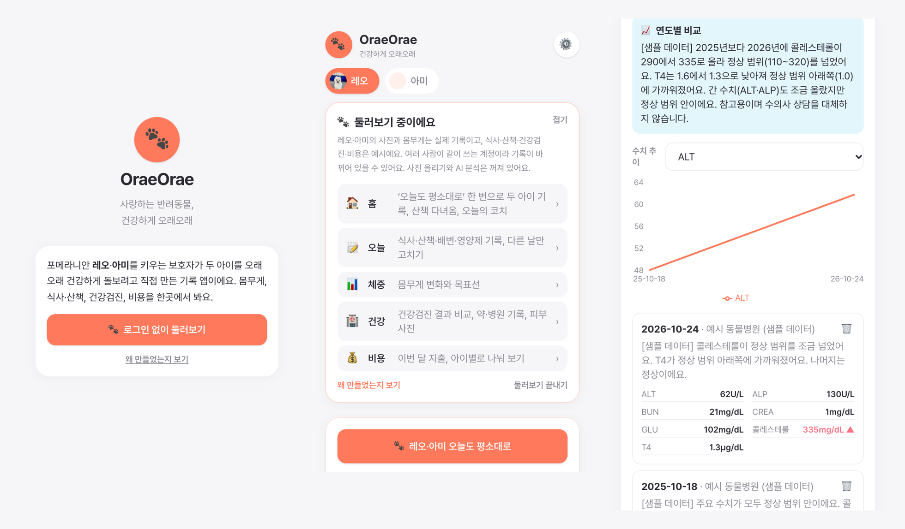
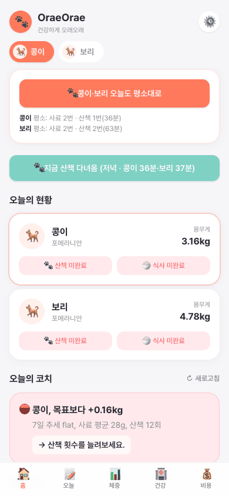
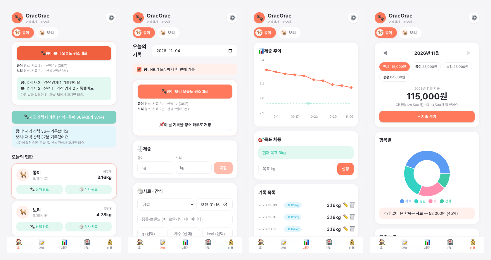

# OraeOrae 🐾

**A daily care app for my two Pomeranians: log both dogs in one tap, track weight against a goal, keep health records and spending in one place, and get AI suggestions for what to do next.**

Built by a non-developer owner working with AI coding agents. This repository is an overview; the source code stays private.

  <a href="https://oraeorae-4mnbzwnkgq-uc.a.run.app"><b>▶ Try the live app</b></a>
  &nbsp;·&nbsp; tap <b>🐾 로그인 없이 둘러보기</b> (“look around without logging in”) on the first screen

The app screens are in Korean. Button names are quoted as they appear on screen, with an English translation.

---

## Why I built it

I built OraeOrae as a dog owner, for my own two Pomeranians, Leo and Ami. I want them to stay healthy for a long time (*orae-orae* means “for a long, long time”), and I wanted answers to three questions:

- **What changes their weight?** Weight control matters most for them, so food, treats, walks, and supplements are logged next to weight.
- **How does their health change as they age?** I wanted each yearly checkup read at a glance and linked to the years before.
- **Can the record follow them to a new vet?** The goal is a history that does not break when we change hospitals, and that I can show to the new vet.

It started from my own needs as their owner, not from a product idea.

One of my dogs has hypothyroidism and both have skin issues. Weight, diet, medication, and vet notes lived in different places, so I could not see what was actually changing. And typing every meal and walk for each dog got tedious, so I stopped logging. OraeOrae turns daily logging into *confirming* instead of *typing*: save a normal day once, tap one button each day, and fix only what was different.

## 30-second tour

1. Home → **🐾 지금 산책 다녀옴** (“back from a walk”): one tap logs a walk for the current time of day, with each dog's usual minutes.
2. Home → **🐾 오늘도 평소대로** (“same as usual today”): both dogs' meals, walks, and supplements are filled in.
3. **오늘** (“today”) tab: change only what was different, and enter both dogs' weights side by side.
4. **체중** (“weight”) tab: weight trend against the goal line.
5. **건강** (“health”) tab: yearly checkups side by side, with a trend chart per value and a written year-over-year comparison.
6. **비용** (“expenses”) tab: this month against last month, split by dog or shared items.

## Features

- **One-tap routine for every dog** — save a logged day as each dog's usual day (food in grams, walks, supplements). One tap fills in what is missing; tapping twice never creates duplicates.
- **Built for more than one dog** — weights side by side, one shared supplement list, one switch to log the same thing for all dogs.
- **Weight tracking with goals** — trend chart, target line, and change since the last weigh-in.
- **Daily coach cards** — short next-step suggestions from the last 7 days of weight, food, and walks (Gemini, with a rule-based fallback).
- **Health records** — upload a checkup result sheet (photo or PDF); AI reads the values and compares them year over year. Medications, vaccines, vet visits, and skin photos by body part.
- **Expenses** — scan a receipt to fill in an expense. Monthly comparison, per-dog filter, category breakdown, 6-month trend.
- **Installable on a phone** (PWA) with Google sign-in.

> Coach cards and checkup summaries are for reference only and do not replace a veterinarian.

## Try the demo

- Tap **🐾 로그인 없이 둘러보기** on the first screen. No account needed.
- The demo shows Leo and Ami's **real photos and weights**, shared on purpose. Meals, walks, medications, two years of checkups, and expenses are **sample data**, labelled as such.
- Everyone shares one demo account, so records may change while you look. Photo uploads, receipt scanning, and AI analysis are off there, and the dogs' profiles are read-only.

## How I build it

- Solo, non-developer owner, building with AI coding agents such as Claude Code. First attempt in 2025, rebuilt from scratch on Google Cloud in June 2026. I use it for my own dogs.
- Every change goes through a pull request with type checks, unit tests, and a build in CI; merging deploys automatically.
- Stack: TypeScript · React · Vite · Tailwind · Express · PostgreSQL (Drizzle) · Gemini · Google Cloud Run, Cloud SQL, Cloud Storage · GitHub Actions

## Status

- Live and used for Leo and Ami. Sign-ups are invite-only; the demo is open to everyone.
- Goal: make the health history easy to share with a new vet. This is not built yet.
